<div align="center">

# 📋 project-plan

### See what Claude Code is doing, answer it from your browser, and keep a record of everything it did.

   

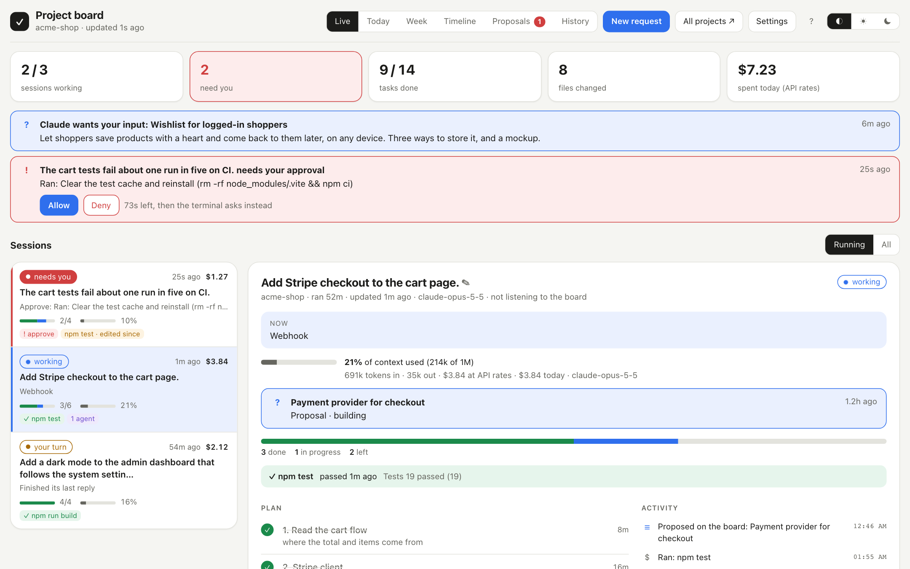

</div>

---

## 🤔 What is this, in plain words?

When you ask Claude Code to do something, it works in your terminal. You can't easily see:

- **what it is planning to do**, and how far along it is;
- **when it is stuck waiting for you**, for example to approve a command;
- **what it actually changed**, what that cost, and whether the tests passed;
- **what happened yesterday**, or in the other terminal window.

**project-plan adds a web page for each project, called the board, that answers all of that live.** You open it in your browser next to your work. Claude keeps it up to date automatically while it works, and you can reply to Claude from the board instead of switching to the terminal.

> 💡 Think of it as a **project manager's dashboard for your AI pair programmer**: a to-do list that updates itself, an inbox for Claude's questions, and a diary of everything it did.

---

## ✨ Why you'll like it

| | Benefit | What it means for you |
|---|---|---|
| 👀 | **See the plan before the work** | Claude writes a task list first. You watch each task go from *to do* → *in progress* → *done*, with timings. |
| 🙋 | **Never miss "Claude is waiting"** | A red banner, a soft chime, a desktop notification and a count in the browser tab tell you when Claude needs you. |
| ✅ | **Approve from the browser** | Press **Allow** or **Deny** on the board instead of hunting for the right terminal. |
| 💬 | **Decide with a form, not a chat** | For "what should we build?" questions, Claude posts a **proposal** with options, a mockup and a plan. You tick boxes and press **Approve**. |
| 🧾 | **A record of everything** | Every request, with what was done, files changed, test results and cost. Searchable, with pins and your own notes. |
| 📊 | **Standups and reports for free** | **Copy as standup** (Today) and **Copy as Markdown** (Week) produce a summary you can paste. |
| 🧪 | **Catch "done" that isn't** | The board warns when tests passed *before* the last edit, and flags tests that pass and fail at random (*flaky*). |
| 💸 | **Know the cost** | Estimated spend per session and per day, with an optional daily budget. |
| 🗺️ | **A live map of your code** | Every project gets an interactive map: parts, screens, endpoints and how they connect, what each request changed, what's being edited right now, a health check, answers to questions, guided flows and blueprints for apps you haven't built yet. |
| 🗂️ | **All projects in one tab** | A hub page lists every project with a board, and you can answer all of them from there. |
| 🔒 | **Private by default** | It runs on your computer. Nothing is uploaded, and there's nothing to install from npm or pip. |

---

## 📚 Contents

- [How it works](#-how-it-works)
- [Get started in 3 steps](#-get-started-in-3-steps)
- [A tour of the board](#-a-tour-of-the-board)
- [Works with other tools (optional)](#-works-with-other-tools-optional)
- [Everyday guide for the team](#-everyday-guide-for-the-team)
- [Words you'll see](#-words-youll-see)
- [FAQ](#-faq)
- [Updating](#-updating) · [Uninstalling](#-uninstalling) · [Troubleshooting](#-troubleshooting) · [For maintainers](#-for-maintainers)

---

## 🧠 How it works

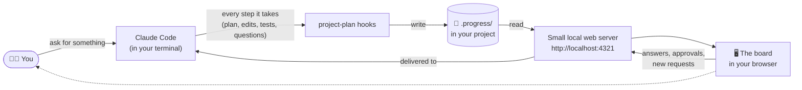

1. **Hooks** are small scripts that Claude Code runs automatically at certain moments: when you send a message, when it edits a file, when it runs a command. This plugin's hooks write what happened into a folder called `.progress/` inside your project.
2. A **tiny web server** on your computer shows that folder as the board.
3. When you answer something on the board, the server saves your answer, and Claude receives it straight away through its **listener** (a background helper Claude starts for itself).

Everything stays on your machine. The only optional outside service is phone alerts through ntfy, which you have to turn on yourself.

---

## 🚀 Get started in 3 steps

### Before you start

You need these on your computer. Open a terminal and check each one:

| You need | Check it with | If it's missing |
|---|---|---|
| **Claude Code** | `claude --version` | [Install Claude Code](https://docs.claude.com/en/docs/claude-code) |
| **Python 3.9+** | `python3 --version` | Comes with macOS and most Linux distributions |
| **Git** | `git --version` | Comes with macOS (or `xcode-select --install`) |
| **GitHub CLI**, signed in | `gh auth status` | `brew install gh`, then `gh auth login` |
| Access to the **Codewing-Internal-Projects** GitHub organisation | open [the repo](https://github.com/Codewing-Internal-Projects/project-plan) in your browser | Ask an admin to add you |

> ℹ️ Works on **macOS and Linux**. Windows isn't supported yet.

### Step 1: Install the plugin (once per computer)

Copy these two lines into your terminal:

```bash
claude plugin marketplace add Codewing-Internal-Projects/project-plan
claude plugin install project-plan
```

<details>
<summary>Prefer doing it from inside Claude Code?</summary>

Type these in a Claude Code session instead:

```
/plugin marketplace add Codewing-Internal-Projects/project-plan
/plugin install project-plan
```
</details>

### Step 2: Restart Claude Code

Close Claude Code and open it again, so it loads the plugin.

> 👍 Installing the plugin **doesn't change any of your projects**. It does nothing until you set up a board in a project (step 3).

### Step 3: Set up a board in your project

Open Claude Code **in your project's folder** and type:

```
set up the progress board
```

(or `/project-plan`). Claude will:

1. create a `.progress/` folder in the project and add it to `.gitignore`, so it's never committed;
2. start the board and **give you a link** such as `http://localhost:4321`;
3. start its listener, so your answers on the board reach it.

**Open the link. That's it! 🎉** From now on, every Claude session in this project shows up on the board.

> 👥 **Teammates don't need the plugin for the project to keep working.** The board writes nothing to the project's shared files (`.claude/settings.json`, `CLAUDE.md`), so people who don't use it see no difference.

---

## 🗺️ A tour of the board

The tabs at the top switch between six views: **Live · Today · Week · Timeline · Proposals · History**. You can also press the keys `1` to `6`.

### 1. Live: what's happening right now


- **The cards at the top** show sessions working, things that **need you**, tasks done, files changed and today's spend.
- **The coloured banners** are things waiting for you: blue for questions, red for approvals, yellow for warnings such as a failing test.
- **The left column** lists your Claude sessions. Each shows its status (*working*, *your turn*, *needs you*), the current task, plan progress, how full its memory is (*context %*) and its cost.
- **The right side** shows the selected session in detail: what it's doing **now**, its **plan** with a time for each task, an **activity** feed, the **files changed**, and its last reply.

### 2. Approve or deny from the browser

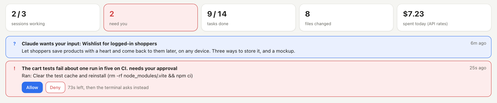

When Claude wants to run something that needs your permission, the board shows **Allow** and **Deny**. Press one and Claude continues. If you don't answer within about 40 seconds, the question goes back to the terminal as usual. (This only happens while the board is open; otherwise the terminal asks straight away.)

### 3. Proposals: decide with a form

When you ask Claude to **brainstorm**, **suggest features** or **choose between approaches**, it doesn't fill your terminal with a wall of text. It posts a **proposal** on the board:

<table>
<tr>
<td width="55%">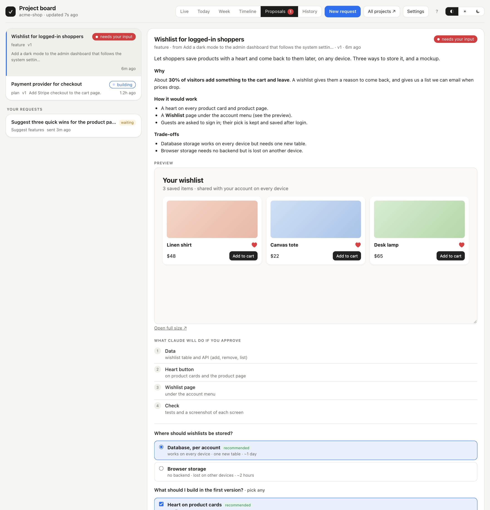</td>
<td width="45%">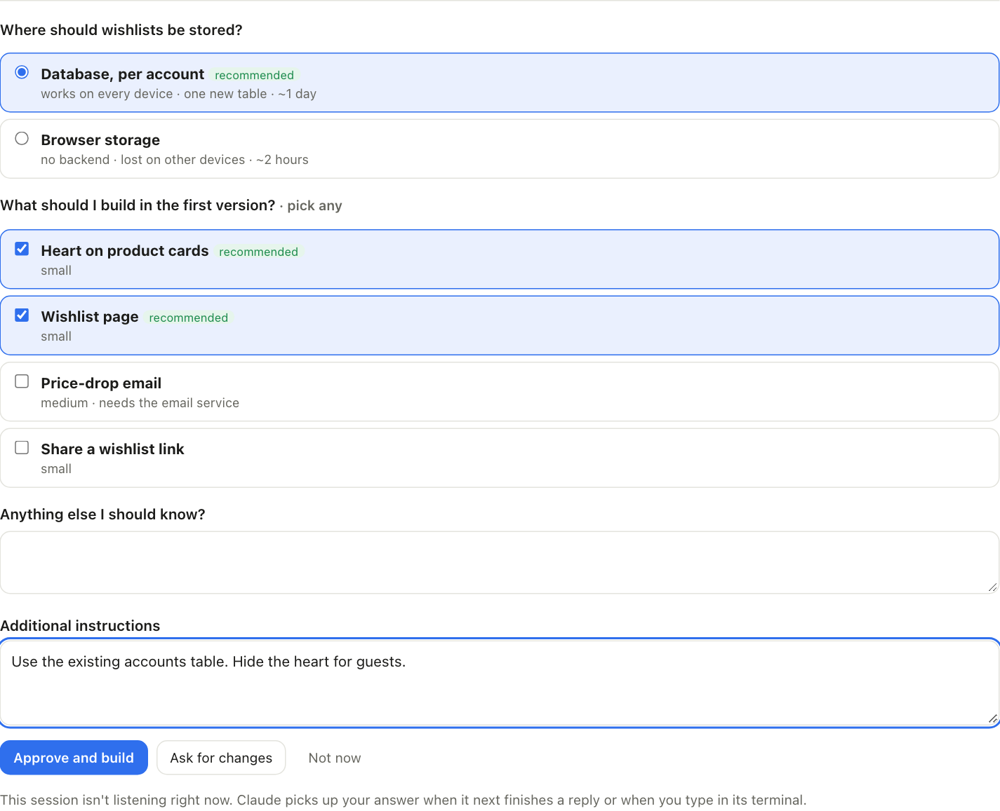</td>
</tr>
<tr>
<td>The idea, why it matters, a <b>live mockup</b>, and the exact plan Claude will follow if you approve.</td>
<td>Pick options (Claude's recommendation is pre-selected), add <b>additional instructions</b>, then <b>Approve and build</b>, <b>Ask for changes</b> or <b>Not now</b>.</td>
</tr>
</table>

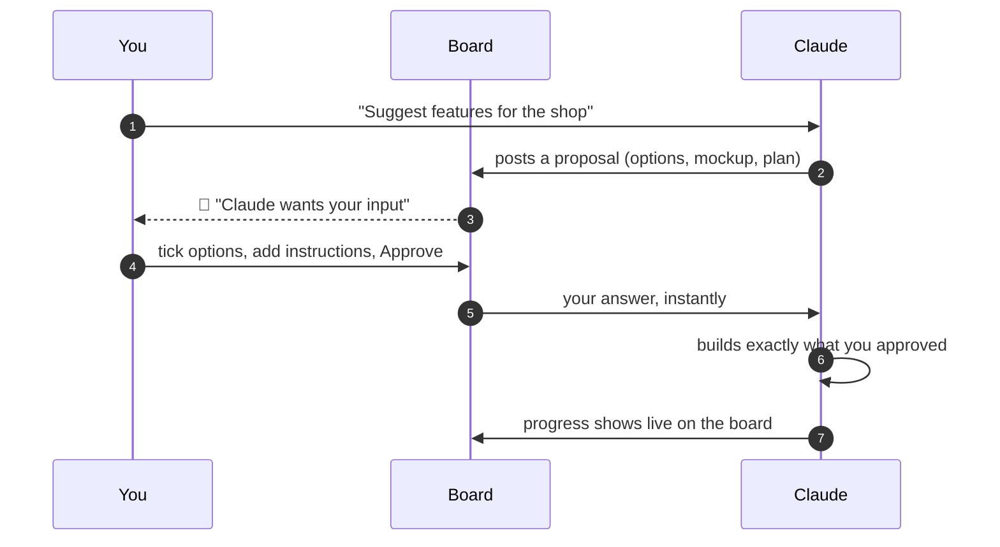

### 4. Send Claude new work from the board

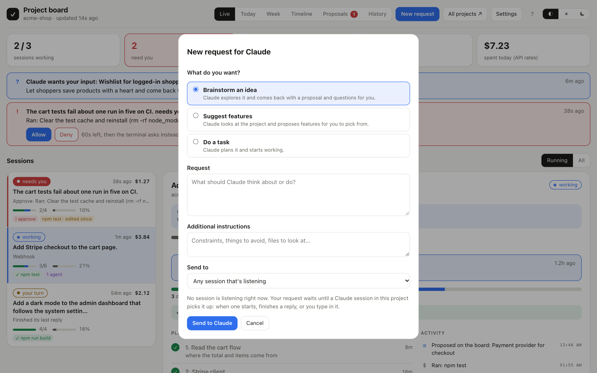

Press **New request** to ask Claude to *brainstorm an idea*, *suggest features* or *do a task*, without touching the terminal. You can send it to a particular session or to whichever one is free.

### 5. See exactly what changed

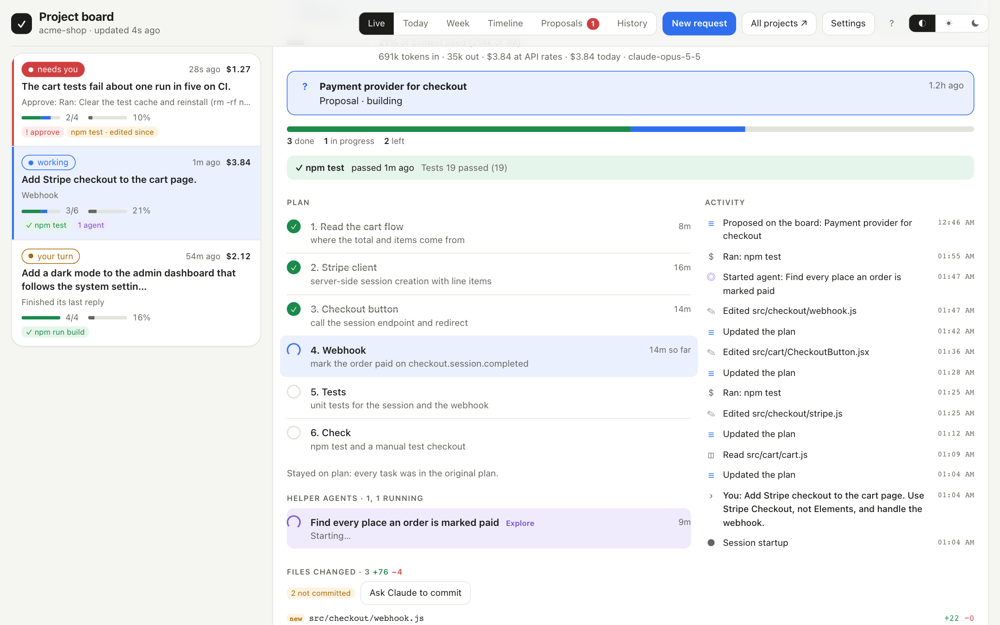

Click any file under **Files changed** to see what was added (green) and removed (red). Files not committed to git yet carry a small tag, and **Ask Claude to commit** sends Claude a request to commit them with a good message.

### 6. Today, Week and Timeline: your reports

<table>
<tr>
<td width="50%">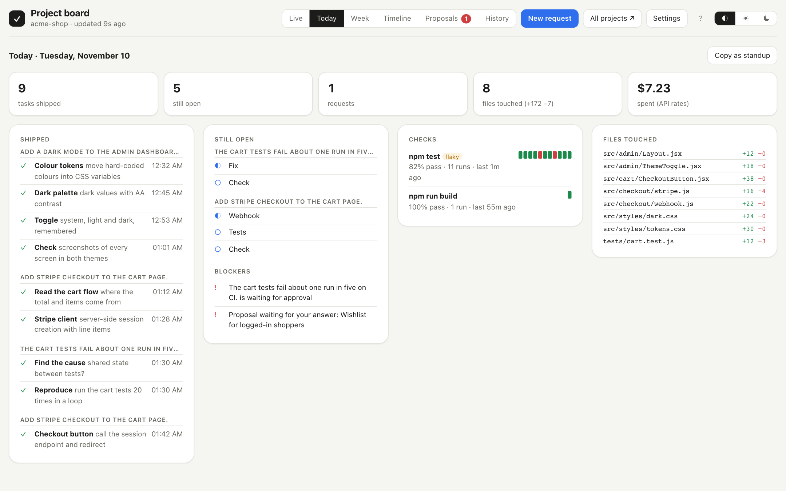</td>
<td width="50%">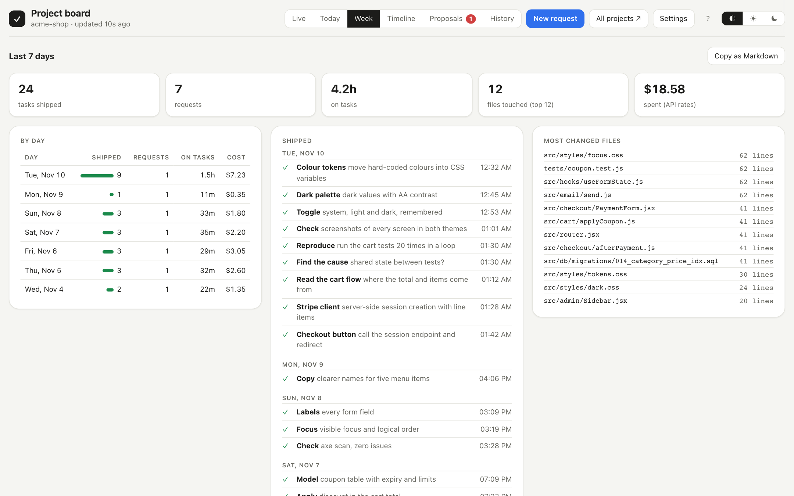</td>
</tr>
<tr>
<td><b>Today:</b> what shipped, what's still open, blockers, test health (with <i>flaky</i> warnings) and files touched. <b>Copy as standup</b> gives you a summary to paste.</td>
<td><b>Week:</b> the last 7 days by day (tasks shipped, time spent, cost), everything that shipped, and the most changed files. <b>Copy as Markdown</b> for a weekly report.</td>
</tr>
</table>

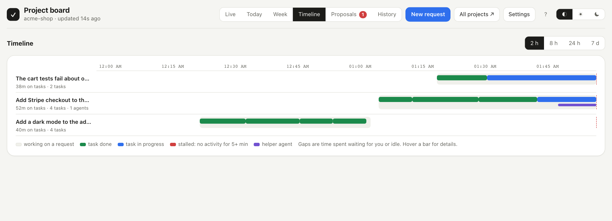

**Timeline:** one row per session. Green bars are finished tasks, blue is the task in progress, red stripes mean nothing has happened for a while, and purple is a helper agent.

### 7. History: every request, forever searchable

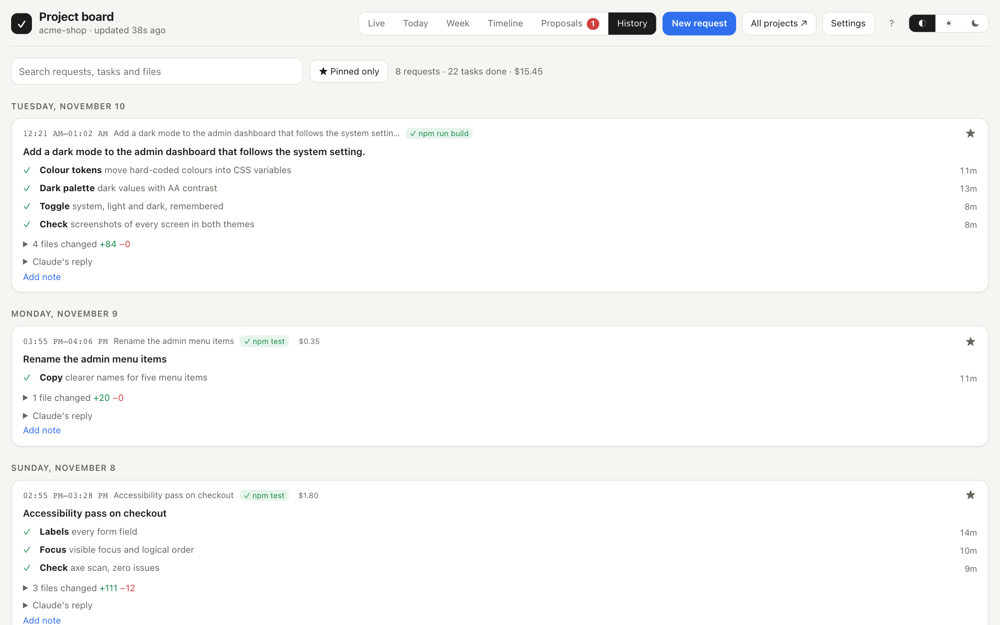

Every request you gave Claude, grouped by day, with the tasks done, files changed, test result, cost and Claude's reply. Search it, **★ pin** the important ones, and **add your own notes**.

### 8. Map: how the project fits together

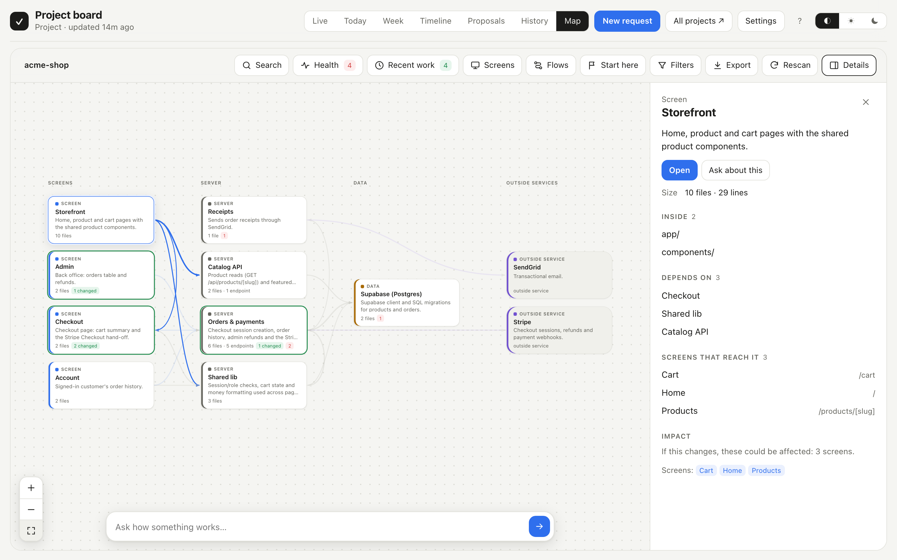

The **Map** tab shows your project as a handful of **parts** (screens, server code, data and outside services like Stripe) with lines for how they connect. Every project gets a map automatically: a free scan draws one from your folders the first time Claude starts there. Say *"make the project map"* and Claude names and describes the real parts once. After that the map **rescans by itself** whenever a session stops, and tells you when parts have changed enough to need a fresh description.

**Getting around:** drag to pan, scroll or pinch to zoom, **F** to fit. **Double-click** a part to go inside it, then into a folder, then a file. Each level shows **Used by** on the left, what's **inside** in the middle and what it **uses** on the right. **Backspace** goes back up. Right-click anything for more (ask about it, copy its path, open it in your editor), and press **?** for all the shortcuts.

<table>
<tr>
<td width="50%">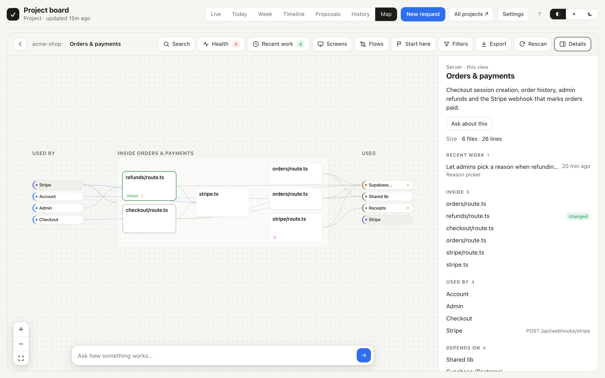</td>
<td width="50%">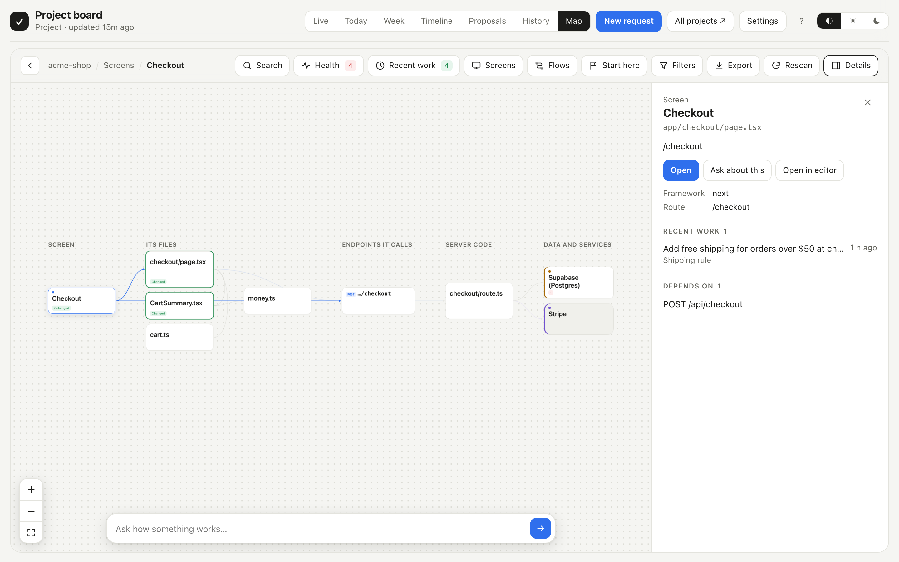</td>
</tr>
<tr>
<td><b>Inside a part:</b> its files (and their endpoints), what calls in, what it relies on. The panel lists the requests that changed it, health issues, and <b>Impact</b>: everything that could break if you change it.</td>
<td><b>Screens:</b> pick any page of your app and see everything behind it: its components, the endpoints it calls, the server code that answers, and the data and services they touch. WordPress admin pages, shortcodes and blocks count as screens too.</td>
</tr>
<tr>
<td width="50%">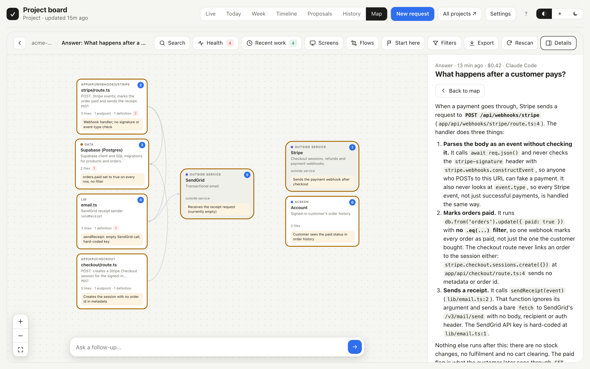</td>
<td width="50%">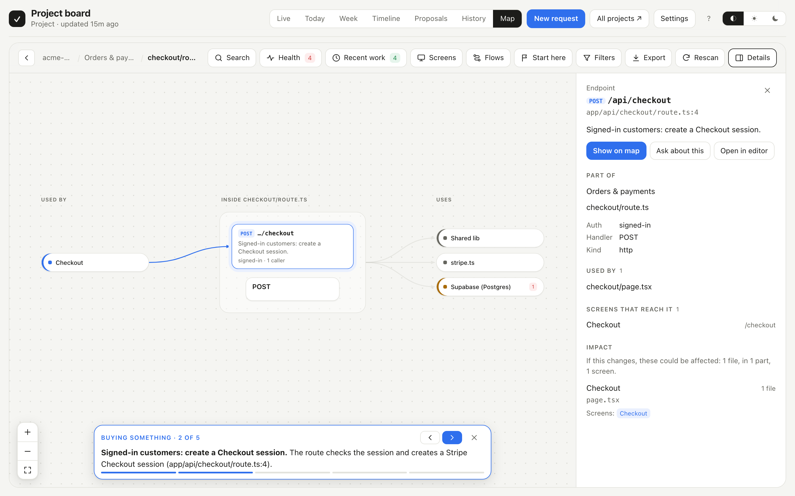</td>
</tr>
<tr>
<td><b>Ask about the code:</b> type a question like <i>"what happens after a customer pays?"</i>. Claude reads the code (it can't change anything) and answers with an <b>answer board</b>: just the pieces involved, numbered in order, each with a note, plus file-and-line references and follow-up questions. Each answer shows what it cost.</td>
<td><b>Flows and the tour:</b> step-by-step walkthroughs of the main jobs, like buying something. Press <b>Request a new flow</b> and describe one in plain words; Claude traces it through the code and saves it. <b>Start here</b> replays a short tour of the app.</td>
</tr>
<tr>
<td width="50%">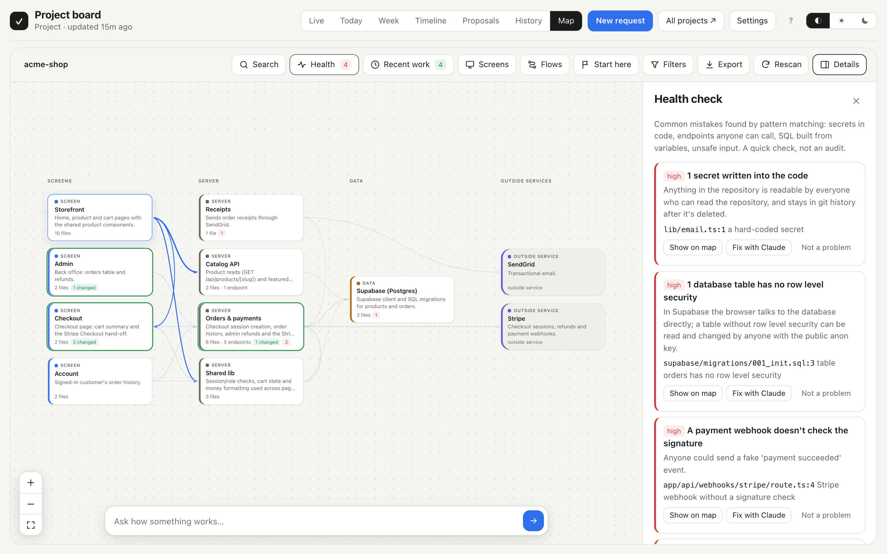</td>
<td width="50%">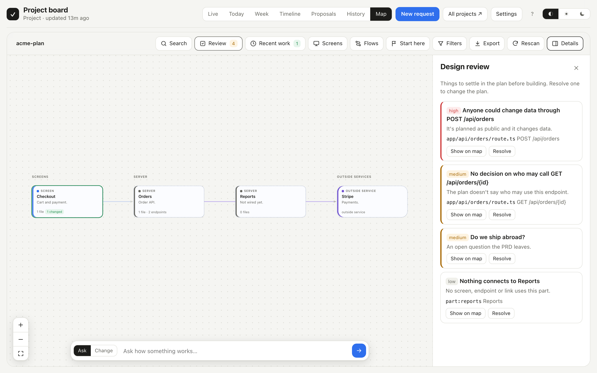</td>
</tr>
<tr>
<td><b>Health check:</b> flags common mistakes, such as keys in the code or sent to the browser, database tables without access rules, endpoints anyone can call, unverified payment webhooks, SQL built from raw input and unused files. <b>Show on map</b> highlights them; <b>Fix with Claude</b> hands the details to a Claude session; <b>Not a problem</b> hides a false alarm (with a reason, if you like).</td>
<td><b>Blueprints:</b> plan an app before it exists. Give Claude a PRD or spec (<i>"make a blueprint from docs/prd.md"</i>) and it draws the parts, files, endpoints and screens it would need. A <b>design review</b> lists open questions and risky decisions; <b>Change</b> reshapes the plan ("also plan out refunds") with <b>Undo</b>; every part has <b>Build this with Claude</b>.</td>
</tr>
</table>

**Live, while you work:** parts changed by today's requests are **green** (follow the green down to the exact files), parts a running session is editing right now show an **editing now** marker, and Live and History cards list the parts each request touched. Click one to jump to it on the map.

**Share it:** **Export** saves the map as one HTML file anyone can open, with nothing to install. You choose whether flows, notes, recent work and health go in; it never includes your code or your folder paths. You can also pin **notes** to files, and the hub shows each project's map health.

<details>
<summary>What the scanner understands</summary>

- **Languages:** JavaScript/TypeScript (incl. Vue, Svelte, Astro), PHP, Python, Go, Rust, Java/Kotlin, Ruby and more for basic structure.
- **Endpoints:** WordPress (`register_rest_route`, `wp_ajax_*`, `admin_post_*`), Express/Fastify/Koa/Hono (with router prefixes), Next.js, SvelteKit, Remix, Nuxt, Astro, NestJS, Firebase Functions, Flask, FastAPI, Django, Laravel, Spring, Actix, Axum, Go routers, and route tables.
- **Screens:** Next.js, React Router, Vue Router, SvelteKit, Remix, Nuxt, Astro, Expo Router, Angular, TanStack Router, and WordPress admin pages, shortcodes and blocks.
- **Connections:** imports, PHP class references, and each front-end request matched to the endpoint that answers it, even across several repos in one folder.
- It's pattern matching, not a compiler: it finds most connections, not all. Ask Claude to add a missing one to the map.
</details>

### 9. All your projects in one tab

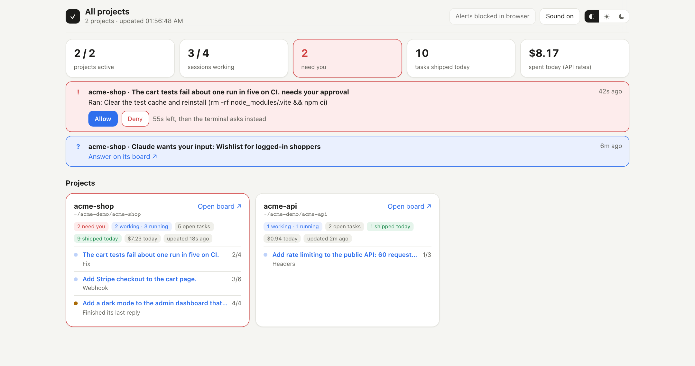

Open **http://localhost:4320**, or click **All projects ↗** on any board, to see every project that has a board. While this tab is open, it gives the alerts for all your projects, and you can approve requests from here too.

### 10. Settings, search and more

<table>
<tr>
<td width="50%">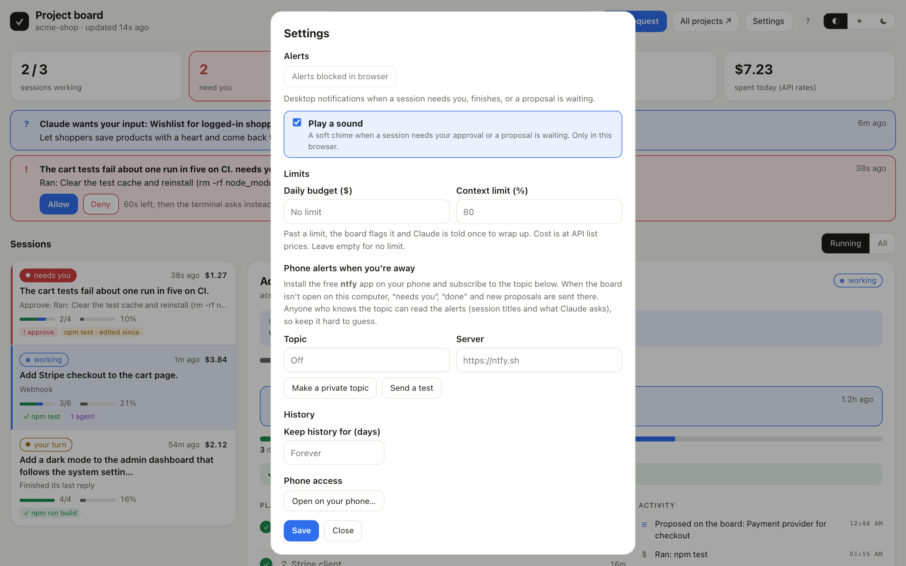</td>
<td width="50%">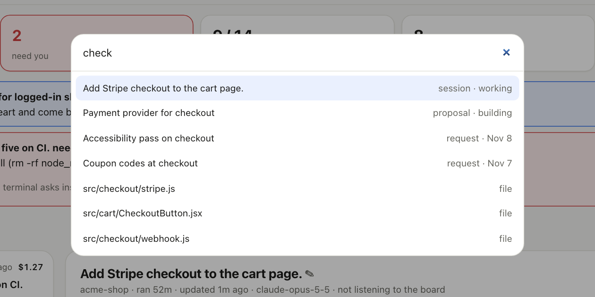</td>
</tr>
<tr>
<td><b>Settings:</b> desktop alerts and sound, a <b>daily budget</b> and <b>context limit</b>, phone alerts when you're away (via ntfy), how long to keep history, and phone access on your Wi-Fi.</td>
<td><b>⌘K</b> (or <b>Ctrl+K</b>): jump to any session, proposal, past request or file. Press <b>?</b> to see all the keyboard shortcuts.</td>
</tr>
</table>

<table>
<tr>
<td width="62%">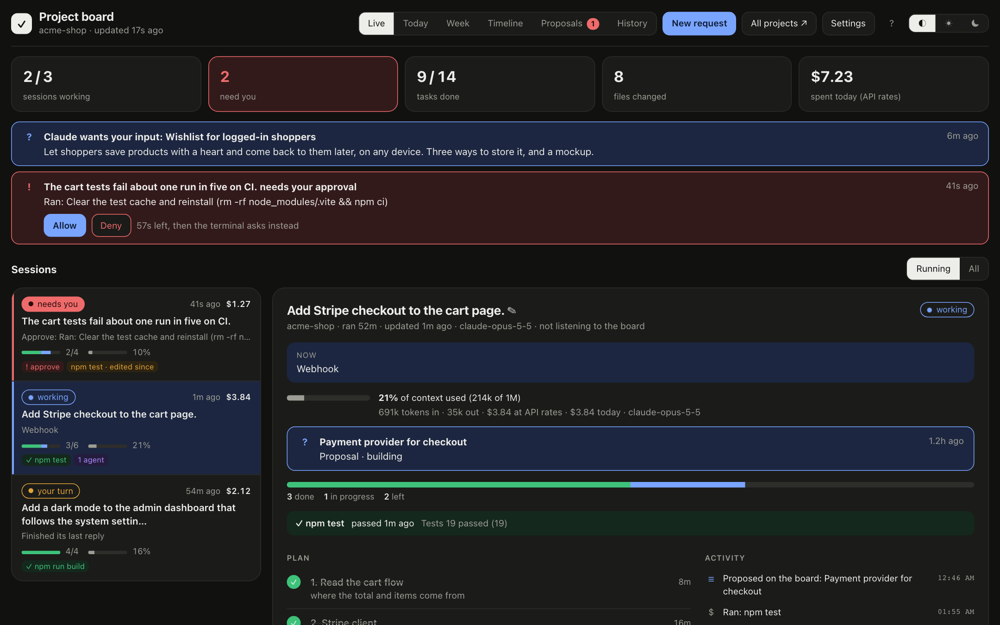</td>
<td width="38%">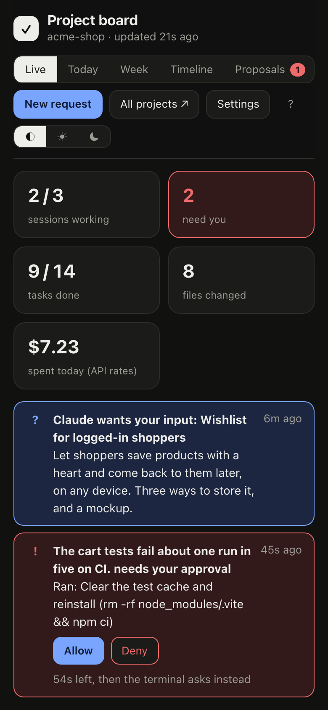</td>
</tr>
<tr>
<td><b>Light and dark themes:</b> follows your system, or pick one with the switch in the top-right corner.</td>
<td><b>Works on phones:</b> ask Claude to <i>"turn on phone access for the board"</i> to open it on your phone over the same Wi-Fi.</td>
</tr>
</table>

---

## 🧩 Works with other tools (optional)

project-plan works on its own. These free tools add more to the board once they're installed. You don't need to remember this list: when one is missing, its place on the board says so and shows the commands to copy.

| Tool | What it adds | Where on the board | Install (in a terminal, once per computer) |
|---|---|---|---|
| **[security-audit](https://github.com/cloudflare/security-audit-skill)** (Cloudflare, a skill) | A real security audit: agents hunt for vulnerabilities and a fresh agent verifies each one. | **Map → Health**: the *Security audit* box, with **Run a security audit**; confirmed findings appear next to the health check issues. | `git clone --depth 1 https://github.com/cloudflare/security-audit-skill /tmp/security-audit-skill`<br>`mkdir -p ~/.claude/skills && cp -R /tmp/security-audit-skill/skills/security-audit ~/.claude/skills/` |
| **[TokenEconomizer](https://github.com/microsoft/TokenEconomizer)** (Microsoft, a plugin) | Cuts token spend: remembers repo facts between sessions, leaves out tools a repo never uses, stops failing loops. | **Savings**: what it learned and what it saved. | `git clone https://github.com/microsoft/TokenEconomizer.git ~/TokenEconomizer`<br>`claude plugin marketplace add ~/TokenEconomizer`<br>`claude plugin install tokeneconomizer@tokeneconomizer` |

Restart Claude Code after installing either one.

---

## 🤝 Everyday guide for the team

Once the board is set up, you mostly just talk to Claude as usual. These habits get the most out of it:

1. **Keep the board open in a browser tab while Claude works.** You'll see the plan straight away, and you can approve requests without switching windows.
2. **Ask for proposals for anything with choices.** Start with *"Brainstorm…"*, *"Suggest features for…"* or *"Which approach should we use for…"* and answer on the board.
3. **Use Additional instructions for constraints**, for example *"no new dependencies"* or *"keep the old API working"*. Claude follows them.
4. **Check the check before you accept "done".** If the board says *"edited since"* next to a test, ask Claude to run it again.
5. **Watch the context %.** Above about 80%, Claude's memory is nearly full. Let it finish the current task, then start a fresh session.
6. **Never commit `.progress/`.** It's your personal, local record. Setup already adds it to `.gitignore`.

Handy things to say to Claude:

| Say this | What happens |
|---|---|
| "open the board" | You get the link again (it restarts the board if needed). |
| "turn on phone access for the board" | You get a private link for your phone on the same Wi-Fi. |
| "turn off phone access for the board" | The board is closed to other devices again. |
| "publish a snapshot of the board" | A read-only copy to share as a private claude.ai page. |
| "remove the board" | The board comes off this project. Your history stays in `.progress/`. |

---

## 📖 Words you'll see

| Word | Meaning |
|---|---|
| **Session** | One Claude Code conversation, usually one terminal window. |
| **Plan / tasks** | The to-do list Claude writes before starting. |
| **Proposal** | A question from Claude with options for you to choose, shown as a form on the board. |
| **Request** | One thing you asked Claude to do. History lists every request. |
| **Listener** | A background helper Claude runs so your answers on the board reach it instantly. |
| **Hook** | A small script Claude Code runs automatically at certain moments. This is how the board gets its updates. |
| **Check** | A test, lint or build command, such as `npm test`. |
| **Flaky** | A check that failed and then passed with no code change in between, so it can't be trusted. |
| **Map / part** | The Map tab's picture of your code. A part is one area of the app, like "Checkout" or "Stripe". |
| **Flow** | A step-by-step walkthrough of one job through the code, like "buying something". |
| **Blueprint** | A map of an app that isn't built yet, planned from a PRD or spec. |
| **Health check** | Automatic checks on the map for common security and quality mistakes. |
| **Context %** | How full Claude's working memory is. When it's full, older details get summarised. |

---

## ❓ FAQ

<details>
<summary><b>Does it cost anything?</b></summary>

No. The plugin is free and runs on your computer. The **cost** it shows is an *estimate* of what Claude's work would cost at API list prices, so you can keep an eye on usage. On a subscription plan it doesn't change what you pay.
</details>

<details>
<summary><b>Does it send my code or prompts anywhere?</b></summary>

No. Everything stays in `.progress/` on your machine and is served only to your own computer. Three things share data, and only if **you** turn them on:
- **phone alerts** send short alert texts through ntfy.sh;
- **phone access** opens the board to devices on your Wi-Fi that have the private link;
- **snapshots** create a copy that you choose to share.
</details>

<details>
<summary><b>Will it change files in my repository?</b></summary>

It creates a `.progress/` folder and adds one line, `.progress/`, to `.gitignore`. Nothing else. It doesn't touch `.claude/settings.json` or `CLAUDE.md`.
</details>

<details>
<summary><b>What if I close the board?</b></summary>

Nothing breaks. Claude keeps working, approvals go back to the terminal, and the board catches up the moment you open it again.
</details>

<details>
<summary><b>Can I use it in several projects at once?</b></summary>

Yes. Each project gets its own board on its own port (4321, 4322, …), and the hub at `http://localhost:4320` shows them all together.
</details>

<details>
<summary><b>Does it slow Claude down?</b></summary>

Not noticeably. Each hook takes a few milliseconds, and in projects without a board it exits immediately.
</details>

---

## 🔄 Updating

You don't have to watch for updates. **Once a day, Claude checks whether a newer version exists and tells you**, and the board shows a notice too. To update, run:

```bash
claude plugin marketplace update
claude plugin update project-plan
```

Then restart Claude Code. Your boards restart with the new version on their own. To check right away: `python3 ~/.claude/project-plan/hook.py check-update`.

<details>
<summary><b>Installed before 1.2.1?</b> Switch to the new install name once</summary>

Versions up to 1.2.0 were installed under an older marketplace name. Run these once, then restart Claude Code; boards and history stay as they are:

```bash
claude plugin uninstall project-plan@codewing
claude plugin marketplace remove codewing
claude plugin marketplace add Codewing-Internal-Projects/project-plan
claude plugin install project-plan
```
</details>

<details>
<summary><b>Moving from the old hand-installed version</b> (<code>~/.claude/skills/project-plan</code>)</summary>

1. Install the plugin (above) and restart Claude Code.
2. In **each** project that has a board, say *"set up the progress board"* again. This removes the old hooks from `.claude/settings.json` and the old block from `CLAUDE.md`, and keeps your history.
3. Then delete `~/.claude/skills/project-plan`.

Do it in this order. If you delete the folder first, that project's old hooks report "file not found" until you rerun setup there.
</details>

---

## 🗑️ Uninstalling

1. In each project, say *"remove the board"* to Claude, or delete the project's `.progress/` folder.
2. Remove the plugin:
   ```bash
   claude plugin uninstall project-plan
   ```
3. If a board is still running, stop it with `lsof -ti :<port> | xargs kill`. The hub uses port 4320.

---

## 🩺 Troubleshooting

| Problem | Fix |
|---|---|
| **The board is empty** | Restart the Claude session so the plugin loads, and check that the project has a `.progress/` folder. |
| **Everything appears twice** | Old hooks from a hand install are still in the project. Say *"set up the progress board"* again. |
| **No Allow / Deny buttons** | The board (or hub) has to be open and visible when the request arrives. Otherwise answer in the terminal. |
| **Your answer says "Waiting for Claude"** | That session's listener isn't running. Type anything in the session, or wait until Claude finishes its reply. |
| **"The board server is out of date"** | Start a new Claude session in the project, or say *"set up the progress board"*. |
| **A test run isn't shown as a check** | Only commands that start with `npm`/`pnpm`/`yarn`/`bun` `test`, `check`, `lint`, `typecheck`, `build` or `e2e`, or with `vitest`, `tsc`, `eslint` or `playwright test`, count. |
| **No update notices** | Run `gh auth status`. You need to be signed in, with access to the organisation. |
| **The link doesn't open** | Say *"open the board"*. Claude restarts the board and gives you the link again. |

---

## 🛠️ For maintainers

<details>
<summary>Repository layout, testing and releasing</summary>

```
.claude-plugin/marketplace.json          the marketplace (named "project-plan"; lists the plugin)
plugins/project-plan/
  .claude-plugin/plugin.json             plugin name and version (the version the update check compares)
  hooks/hooks.json                       the hooks; they run hook.py, which does nothing outside board projects
  skills/project-plan/SKILL.md           instructions Claude follows
  skills/project-plan/scripts/
    hook.py                              hooks, CLI, board server, hub server, update check
    setup.py                             set up or remove a board in a project; the rules text
    index.html                           the board page (copied into each project's .progress/)
    hub.html                             the all-projects hub page
    codemap.py                           the project map: scanner, build, health check, lookups
    mapapp.py                            the map's AI and sharing side: Ask, flows, blueprints, export, notes
    map.html                             the interactive map page (shown in the board's Map tab)
tests/test_codemap.py, test_mapapp.py   self-checks for the map (python3 tests/test_codemap.py && python3 tests/test_mapapp.py)
docs/map-format.md                       the map's data format and server API
docs/images/                             README screenshots
```

**Adding an integration with another plugin or skill:** detect whether it's installed (for example `audit_skill()` in `codemap.py`). Where its feature would appear, show the install commands with **Copy** buttons when it's missing, never a button that can't work. Then add a row to [Works with other tools](#-works-with-other-tools-optional).

**Try your changes** without installing them:

```bash
claude plugin validate .
python3 tests/test_codemap.py && python3 tests/test_mapapp.py   # the map
claude --plugin-dir ./plugins/project-plan       # loads your working copy for this session only
```

**Release a new version:**

1. Bump `version` in **both** `plugins/project-plan/.claude-plugin/plugin.json` and `.claude-plugin/marketplace.json`.
2. If the board or hub server changed, also bump `VERSION` in `hook.py`. Running servers restart when it changes.
3. Add an entry to `CHANGELOG.md`.
4. Commit and push, then run `claude plugin tag plugins/project-plan --push`.

Team members are told about the new version within a day, at their next session start.

**Screenshots** come from a demo project with made-up data (an "acme-shop" store). Retake them after visible UI changes so the README stays accurate.
</details>
